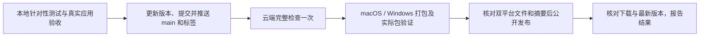

# Loop 简化发布流程

用户于2026-10-29确认，所有会话均采用本流程。它是当前发布操作的统一入口，取代旧文档和维护技能中“每次发布都本地全量检查、双平台打包、发布后再提交回执”的要求。历史报告只作为证据，不作为当前操作清单。

## 1. 本地完成改动与验收

- 检查 Git 状态并同步远端，保留无关改动和其他会话工作区，不重置或整库清理。
- 按改动选择相关测试；涉及交互时运行真实 Electron 应用，验证实际行为。运行 `git diff --check`。不以静态代码断言代替真实交互验证。
- 产品变更按用户要求完成真实候选验收。用户已批准当前候选并要求发布时直接继续，不再重复询问。批准后不悄悄改变产品代码或设计。
- 已有有效测试与验收可复用；源码、依赖或相关环境改变后，再运行受影响检查。常规发布不强制本地 `npm run check`，也不强制本地 macOS 和 Windows 双平台构建。

## 2. 准备版本并推送

- 再核对最新远端 main 和版本标签，从远端最高版本决定下一个版本，默认 patch 加一；不用历史文档中的固定版本号。
- 更新 `package.json` 和 `package-lock.json` 根版本，准备清楚的更新摘要。若批准后才调整版本，说明这项元数据变更。
- 只暂存本次相关文件，检查暂存差异；正常提交并推送 main，再推送对应 `v*` 标签。不强推，不移动已公开标签。main 被其他工作区占用时先核对该工作区是否可安全快进，保留固定工作区与无关改动。
- 阶段整改仍遵守 `docs/frontend-remediation/RELEASE.md` 的累计状态和授权边界；具体发布检查采用本文，不重新实施阶段0–8。

## 3. 云端完成正式检查与发布

以当前标签、当前提交的 `.github/workflows/release.yml` 为准：

1. 在 Ubuntu 上安装依赖，集中运行一次 `npm run check`；成功后准备未公开的 Release 草稿。
2. macOS 和 Windows 并行打包，并运行依赖本机系统行为的桌面专项测试；各平台不再重复整套 `npm run check`。
3. 在实际包中运行知识笔记回归，Windows 运行历史安装包升级矩阵。保留失败证据；开发环境通过不等于实际包通过。
4. 按真实文件字节核对更新元数据与摘要，再上传到草稿。
5. 汇总两个平台的清单，验证文件完整性、版本/提交一致性、更新摘要及服务器文件摘要。全部通过后才公开 Release 并设为最新版。

`main` 和 PR 的应用代码检查独立保留，供日常集成验证；它不打包安装程序。只改 Markdown 或 `docs/` 的提交不触发该应用检查，混有应用、测试、依赖、工具或工作流变更时仍执行。手动检查入口保留。

## 4. 核对结果并结束

- 等待本次工作流完成，检查正式 Release 已公开、标签正确、双平台文件及更新元数据完整，并核对最新版本和下载入口。
- 报告版本、源码提交、发布链接、通过的检查和仍未验证项。“已推送”“草稿已上传”“已正式发布”分别如实表述。
- 默认直接在会话报告结果，不为补写发布回执固定新增提交。需要交接时可更新相应记录；纯文档提交不再触发应用检查，也不移动版本标签。
- 失败按当前原因处理，优先重试失败部分；不因网络上传失败重新做有效的本地验收，不跳过正式发布门禁。

## 何时追加本地打包

只有改动涉及安装包、更新器、打包资源/依赖，或需要诊断云端失败、离线交付、用户明确要求时，才构建相关平台并执行相应专项检查。选择新的输出目录，保留运行中的候选与用户资料；不为流程清理删除整个 `release/`。

这不减少产品改动所需的针对性检查，也不取消云端实际包、Windows 升级和发布文件完整性门禁。仅修改发布规范或工作流时验证相应文档、配置和发布工具即可，不启动应用候选验收或自动发布新版本。
