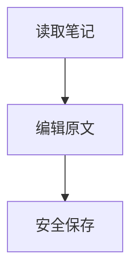

# 日常知识笔记

中文输入与 Emoji 😀，原文 **加粗**、*斜体*、***粗斜体***、~~删除~~、==高亮== 和 `inline_code`。

## 清单

- 第一层
    - 第二层
        - 第三层
1. 有序项目
2. 后续项目

- [ ] 尚未完成
- [x] 已经完成

> 第一层引用
> > 第二层引用

> [!note] 注意事项
> 这里是 Callout 正文。

| 项目 | 左对齐 | 居中 | 右对齐 |
| --- | :--- | :---: | ---: |
| 一 | 内容 | 123 | 456 |
| 二 | a\|b | `x` | 789 |

```cpp
#include <stdio.h>
int main() {
    printf("中文 😀\n");
    return 0;
}
```

[普通链接](https://example.com) 与 [相对笔记](./目标笔记.md#目标标题)。


脚注引用[^说明]。

[^说明]: 这是脚注的内容。

行内公式 $E = mc^2$。

$$
\sum_{i=1}^{n} i = \frac{n(n+1)}{2}
$$



[[目标笔记]] 与 [[目标笔记|显示名称]]，标题链接 [[目标笔记#目标标题]]。

![[目标笔记#^sample-block]]

%% 注释中的 [[不是真实链接]] %%

转义：\*不是斜体\*、\[[不是真实链接]]。

---

### 三级
#### 四级
##### 五级
###### 六级

保留连续空行。


最后一行。
